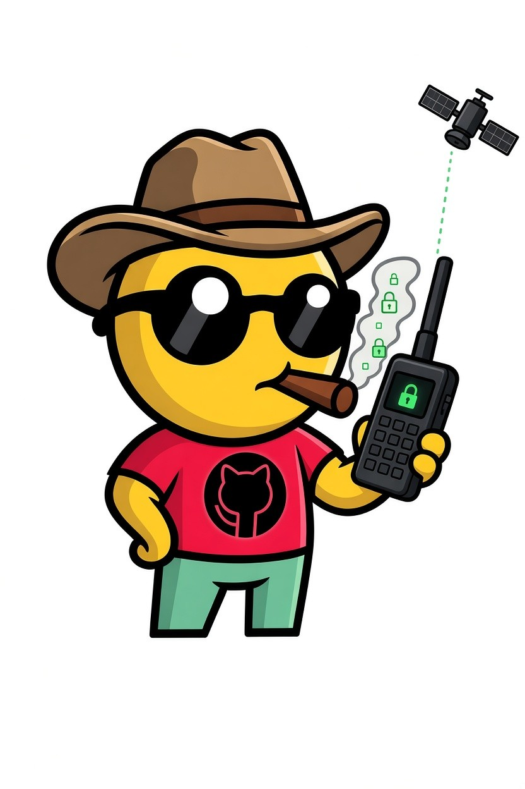
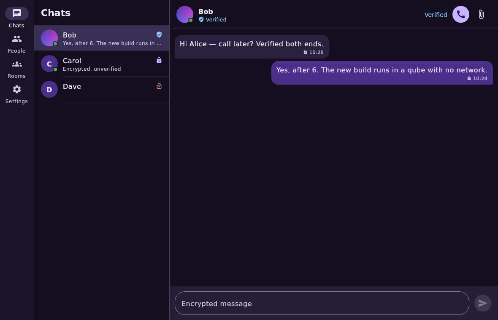
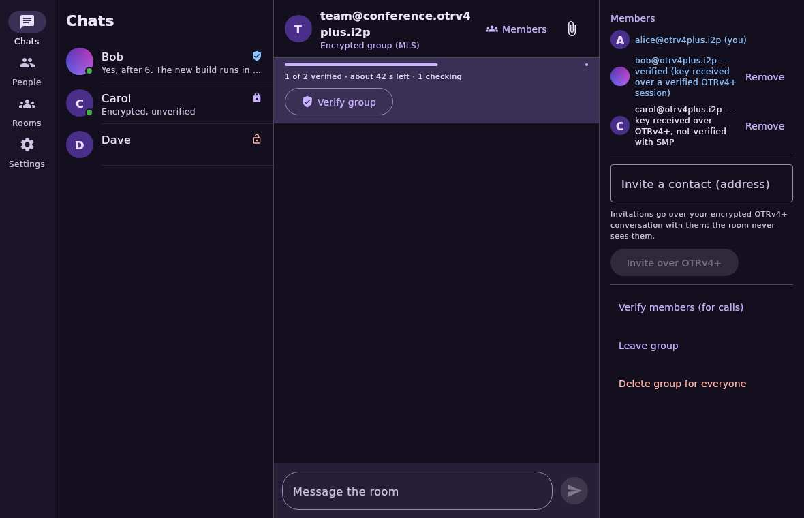
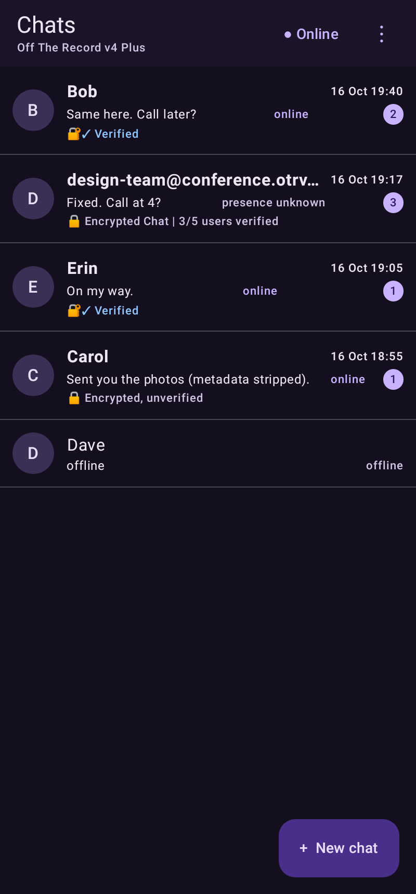
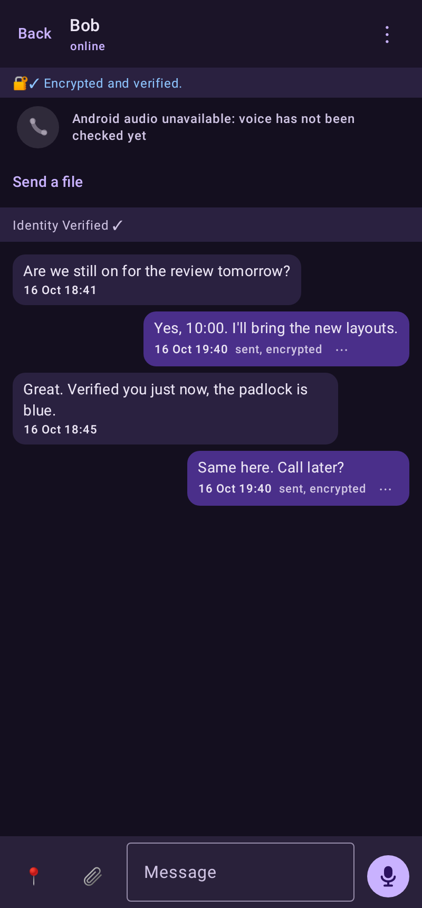
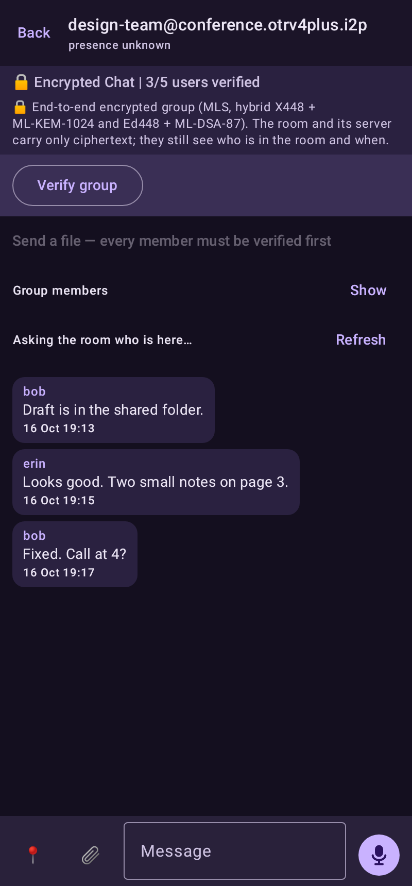
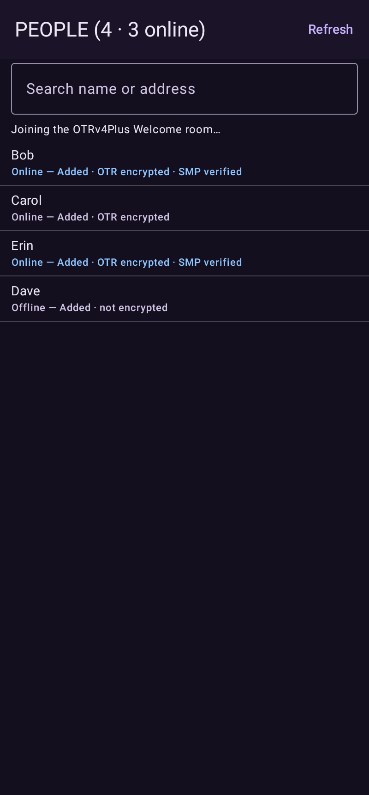

<p align="center">
  
</p>

<h1 align="center">OTRv4+</h1>

<p align="center"><strong>Private messaging and voice over I2P</strong></p>

<p align="center">
<code>v10.31.0 · Rust core 0.13.2 · Android 0.7.0 (pre-release) · Desktop 0.14.2 (pre-release) · chat (X448 + ML-KEM-1024, AES-256-GCM) · group chat (MLS: X448 + ML-KEM-1024, Ed448 + ML-DSA-87, AES-256-GCM) · hybrid PQC SMP (ML-KEM-1024 + ML-DSA-87 + ZKP) · voice (X448 + ML-KEM-1024, AES-256-GCM) · I2P SAM · AAudio · TUI</code>
</p>

OTRv4+ is an open-source client for end-to-end encrypted chat, encrypted
group chat, file transfer and voice calls. It is built around the I2P network
and needs no phone number. Tor and TLS also work for chat.

**Security status: extensively tested and hardened through developer-led and AI-assisted analysis, but not independently audited.**
See [Security assessment and audit status](#security-assessment-and-audit-status) for what that covers and what it does not.

## Screenshots

| Desktop: a verified conversation | Desktop: an encrypted group |
|---|---|
|  |  |

<p>   <br><sub>Android, left to right: chats, a verified conversation, an encrypted group, people. Both apps' screenshots are rendered by their tests from made-up accounts.</sub></p>

## Android app (experimental)

**Download:** open the
[Releases page](https://github.com/muc111/OTRv4Plus/releases). Only the
newest Android build is kept there, so the one you see is the one to test.

1. Under **Assets**, tap `otrv4plus-<commit>-release.apk` (the `-debug.apk`
   is for diagnostics); optionally check its `release sha256`.
2. Open it and allow installs when Android asks. If Android refuses an
   update, uninstall the old build first (builds use a CI signing key).

**No separate I2P app is needed.** The app has an I2P router built in
(i2pd, SAM bridge on loopback only, relaying nothing for others). It uses an
I2P app already running on the phone when one answers, and its own router
otherwise. The first
start takes a few minutes (it joins I2P), later ones a minute or two. Android 8+.

**What has been tested on a phone:** sign-in, contacts, 1:1 chat, rooms, OTRv4+ encryption, SMP identity verification, encrypted file transfer with a Termux peer, two-way voice calls (app to app, and app to Termux; a regression over the built-in router is fixed in rc.162, to be re-tested), group voice calls, end-to-end encrypted group chat (four accounts on two phones: two in the app, two in Termux, all sending and receiving), and account creation and login on an ordinary clearnet server (yax.im, over TLS with the certificate verified).
**Not yet tested on a phone:** the newest additions listed in [CHANGELOG.md](CHANGELOG.md). The step-by-step test list is [docs/ANDROID_CALL_AND_FILE_DEVICE_TEST.md](docs/ANDROID_CALL_AND_FILE_DEVICE_TEST.md).

## Project status

| Area | Status |
|---|---|
| Chat over I2P, TLS | Working, tested live between two peers |
| Chat over Tor | Implemented, not yet tested against a real hidden service |
| Hybrid PQC handshake, ratchet and SMP | Working, not externally reviewed |
| File transfer | Working (XMPP) |
| Voice over I2P | Working between two phones, in Termux and in the app; still being tuned |
| Android app | Chat, OTRv4+, SMP, files and calls (to the app and to Termux) tested on phones |
| Encrypted group chat (MLS) | Working: four clients (two Android, two Termux) on two phones send and read each other's messages, on the hybrid post-quantum suite. Group voice calls tested on phones (rc.89). Ordinary rooms (and the Welcome room) are plain XMPP rooms that the server can read. See [Encrypted group chat](#encrypted-group-chat-mls) |
| Security review | Extensive developer-led and AI-assisted review, fuzzing, and known-answer and cross-implementation testing; **no paid independent audit yet**. See below, [docs/CRYPTO_AUDIT_2026-09.md](docs/CRYPTO_AUDIT_2026-09.md) and [docs/SECURITY_AUDIT_2026-10-11.md](docs/SECURITY_AUDIT_2026-10-11.md) |

## Server capacity (stress test)

On one 2015 ThinkPad T450 running Prosody, measured with the built-in stress test (encrypted groups of 20, each user sending a message a minute, local connections; I2P not yet measured): 800 users online used 37% of one core and 303 MB, delivery 0.31 s typical / 0.56 s slowest 5%, ~100% delivered; **1,600 users** used about 40% (p95 0.5 s). The server is capped at 1,600 online, 10 sign-ins a second and 5,000 accounts. Method and raw results: [docs/STRESS_TEST.md](docs/STRESS_TEST.md); limits: [docs/SERVER_HARDENING.md](docs/SERVER_HARDENING.md).

## Security assessment and audit status

OTRv4+ has had extensive developer-led security review and hardening: Rust unit and
integration tests, ML-KEM-1024 known-answer tests and a cross-check against Go's
`crypto/mlkem`, X448/Ed448 differential tests, cargo-fuzz on every Rust parser of
untrusted input, attack and property tests, Python and Kotlin suites, `cargo audit`
in CI, threat-model and Rust-authority reviews, AI-assisted review, and physical tests
on Android. Findings were fixed, each with a regression test.

It has **not** had a paid independent third-party audit or a formal external
cryptographic assessment, and that work is not equivalent to one. Known limitations:
[docs/SECURITY_ISSUES.md](docs/SECURITY_ISSUES.md) (A1 and A2 are addressed by protocol v2,
which both peers must run; L1, the formal deniability claim, stays open). The evidence, layer by layer: [SECURITY.md](SECURITY.md#security-assessment-and-audit-status).

## Cryptography

Hybrid classical + post-quantum cryptography: X448 with ML-KEM-1024 for key
agreement, Ed448 with ML-DSA-87 for authentication, keying established
AES-256-GCM for the message itself. Unlike the Ed448 ring signature, the
handshake's ML-DSA-87 signatures are attributable: taking part can be proven ([SPEC §10.1](docs/SPEC.md)).

What actually encrypts a message, top to bottom:

```
        X448  +  ML-KEM-1024              key agreement (DAKE)
  Ed448 ring signature  +  ML-DSA-87      authentication (ML-DSA-87 both ways)
                  |
                  v
      OTRv4+ double ratchet (v2)          fresh ML-KEM-1024 secrets folded into
      SHAKE-256 key schedule              the root key, from the first DH step
                  |
                  v
             AES-256-GCM
                  |
                  v
       encrypted OTR message
```

All of this runs in the Rust core (`otrv4_core`). Python handles networking
and Kotlin handles the Android screens; neither holds session keys. SMP
(identity verification) is also hybrid post-quantum and runs in Rust.

Details, design notes and caveats are in [docs/TECHNICAL.md](docs/TECHNICAL.md) and
[docs/SPEC.md](docs/SPEC.md).

## Encrypted group chat (MLS)

> **MLS+** — MLS (RFC 9420) on a hybrid post-quantum ciphersuite (`0xF0A1`, X448 + ML-KEM-1024 / Ed448 + ML-DSA-87). Not interoperable with standard MLS.

Secure groups use **MLS+** through OpenMLS, with every primitive from the same Rust core: hybrid KEM **X448 + ML-KEM-1024**, composite signature **Ed448 + ML-DSA-87** (both must verify), AES-256-GCM, HKDF-SHA-384 (ciphersuite 0xF0A1). Standard MLS suites have no post-quantum protection; these groups resist "record now, decrypt later". The XMPP room carries only `?OTRv4MLS1:` ciphertext. Invitations and Welcomes travel inside 1:1 OTRv4+ sessions; keys move on at every membership change and on a timer; a removed member reads nothing after the removal; messages typed while a group resyncs wait instead of being lost. The server still sees the room, its members and message timing. 0xF0A1 is in the IANA private-use range (0xF000–0xFFFF), which is the correct place for a suite that isn't registered; the hybrid constructions are this project's own, not independently audited. Details: [docs/TECHNICAL.md](docs/TECHNICAL.md#encrypted-group-chat-mls), [docs/MLS_SECURITY_HARDENING.md](docs/MLS_SECURITY_HARDENING.md).

**Known limits**
- **MLS+ is not standard MLS.** Groups use an unregistered ciphersuite (`0xF0A1`, in the IANA private-use range) and cannot be joined by Wire, Element, or any other RFC 9420 implementation.
- **About 100 members per group.** A Welcome carries the whole ratchet tree (~9.4 KB per member) and the core refuses MLS+ messages over 1 MiB, so joins stop near 100 members ([docs/STRESS_TEST.md](docs/STRESS_TEST.md)).

## Quick start

**Pick a branch; every command below names one.** Both ends of a conversation need the same one.

| Branch | What it is |
|---|---|
| `dev` | Newest. The Android test APK on the Releases page is built from it. |
| `main` | Stable: `dev` once tested on devices, merged now and then, so it can be behind. Has protocol v2 since 2026-10-25; a `main` clone older than that is refused by the current APK. |

`git pull` stays on your branch. Switch a clone: `git fetch origin dev && git checkout dev` (or `git checkout main`), then build again.

### Desktop app (Ubuntu, Debian, Qubes OS)

Built from source on your machine. **Ubuntu 24.04+ / Debian 13+**, one line (re-run to update):

```bash
# dev (matches the current APK):
sudo apt install -y git && git clone -b dev https://github.com/muc111/OTRv4Plus.git ~/OTRv4Plus && bash ~/OTRv4Plus/desktop/install.sh
# main (stable):
sudo apt install -y git && git clone -b main https://github.com/muc111/OTRv4Plus.git ~/OTRv4Plus && bash ~/OTRv4Plus/desktop/install.sh
```
- **Run it:** your applications menu → **OTRv4+**, or `otrv4plus-desktop` in a terminal (in `~/.local/bin`; log out and in once if the command is not found). The installer starts it the first time; the window title shows the desktop version.
- **Update:** **Desktop needs only `desktop/install.sh`.** Run it again: it pulls (no separate `git pull`), installs apt packages and Rust if missing, runs `Rust/build.sh` for you and refreshes the menu entry. `Rust/build.sh` alone builds only the core for the terminal clients below. Details: [desktop/README.md](desktop/README.md#install-on-ubuntu-or-debian). Qubes OS 4.2: [qubes/README.md](qubes/README.md).

### Termux, Ubuntu and other Linux (terminal clients)

**1. Install the tools.** Python 3.12 or newer is required.

On **Termux**: `pkg install python rust openssl clang git`

On **Ubuntu 24.04+ / Debian 13+** (Rust from rustup; the distribution's rustc is too old):

```bash
sudo apt install git python3 python3-venv build-essential curl libopus0 pulseaudio-utils
curl --proto '=https' --tlsv1.2 -sSf https://sh.rustup.rs | sh -s -- -y
. "$HOME/.cargo/env"     # puts Rust on this terminal's PATH (new terminals have it)
```

Do not `pip install` anything: `build.sh` puts the Python modules in the project's own
`.venv` (Ubuntu refuses a system-wide pip install: "externally-managed-environment").
`libopus0 pulseaudio-utils` are for calls (Termux: `pkg install libopus termux-api`);
`build.sh` installs the opuslib binding and says if voice is missing anything.

**2. Download and build the Rust core** (the first run on a phone also compiles
the build tool once, so it takes longer; later builds are much faster):

```bash
git clone -b dev https://github.com/muc111/OTRv4Plus.git    # or -b main (see Pick a branch)
cd OTRv4Plus/Rust
bash build.sh
cd ..
```

`build.sh` sets up its own Python environment in `.venv`, runs the Rust tests and
lints, installs the core (with secure groups) and ends with `BUILD OK`. Keep Termux
open while it runs; details in [docs/TECHNICAL.md](docs/TECHNICAL.md#buildsh-in-detail).

**3. Update later.** Pull, then rebuild the core (both Python and Rust change):

```bash
cd ~/OTRv4Plus
git pull                         # stays on dev or main, whichever you cloned
cd Rust && bash build.sh && cd ..
git log -1 --format='%h %ad'     # check you are on the latest commit
```
Keys and settings live in `~/.otrv4plus`, outside the repository; updates leave them.

**4. Networks.** For I2P, run an I2P router with the SAM bridge on port 7656: on a
phone the I2P app ("Use SAM bridge" on); on Ubuntu/Debian `sudo apt install i2pd`
(SAM is on by default). For Tor, Orbot or `tor` with SOCKS on port 9050.

**5. Run it.**

XMPP over I2P (chat, files and voice):

```bash
PYTHONMALLOC=malloc .venv/bin/python otrv4plus_xmpp.py \
  --jid you@yourserver.i2p --peer friend@yourserver.i2p
```
Add `--server <address>.b32.i2p` if the server name does not resolve; `--voice-debug` for call stats.

IRC (defaults to `irc.postman.i2p` over I2P; `-s irc.libera.chat` for TLS):
`PYTHONMALLOC=malloc .venv/bin/python otrv4+.py`

**6. First commands** (XMPP; IRC uses the same `/otr` and `/smp`):

```
/otr              start an encrypted session
/smp              verify identity with a passphrase agreed in person
/call             encrypted voice call (after SMP); /answer, /hangup
/sendfile <path>  encrypted file (after SMP; asks y/n to strip metadata)
/status           session, trust and verification state
/help             every command
```

Encrypted group chat (XMPP): `/group create mls3` (then its passphrase),
`/group invite mls3 bob`, `y` to join, then just type; `/group verify mls3`
checks every member, then `/group call mls3` or `/sendfile` (to the group).
App: Rooms, "Create end-to-end encrypted group"; Verify, Call, Send a file.
Building on musl (Alpine), every option and all commands: [docs/TECHNICAL.md](docs/TECHNICAL.md).

## Documentation

[docs/TECHNICAL.md](docs/TECHNICAL.md) (full reference) · [docs/SPEC.md](docs/SPEC.md) (wire protocol) · [SECURITY.md](SECURITY.md) (threat model, known issues) · [CHANGELOG.md](CHANGELOG.md) · [docs/MLS_SECURITY_HARDENING.md](docs/MLS_SECURITY_HARDENING.md) (group chat design) · [docs/OTRV4PLUS_CAPABILITY.md](docs/OTRV4PLUS_CAPABILITY.md) (who can receive OTRv4+) · [docs/PROSODY_USER_DISCOVERY.md](docs/PROSODY_USER_DISCOVERY.md) (People list, Welcome room) · [CONTRIBUTING.md](CONTRIBUTING.md) · [all documents](docs/README.md)

Running a server: [docs/STRESS_TEST.md](docs/STRESS_TEST.md) · [docs/SERVER_HARDENING.md](docs/SERVER_HARDENING.md) (limits, one-command install) · [docs/SECURITY_SESSIONS.md](docs/SECURITY_SESSIONS.md) (one session per account)

**Relationship to OTR.** OTRv4+ is an independent implementation and extension of
OTRv4, not affiliated with, endorsed by, or connected to the original OTR
developers or otr.cypherpunks.ca, and uses none of their code, artwork or
logos. It is not wire-compatible with stock OTRv4 ([SPEC §0](docs/SPEC.md)).

## License

OTRv4+ is dual-licensed: `AGPL-3.0-only OR LicenseRef-OTRv4Plus-Commercial`.

- [AGPL-3.0](LICENSE) is the default. You may use, change and share it; if you
  distribute it or run a modified version as a network service, you must
  offer your source.
- A [commercial licence](LICENSE-COMMERCIAL.md) is available for closed-source
  use.

Releases up to and including v10.16.2 were published under GPL-3.0, and
anyone who received them keeps those GPL-3.0 rights permanently. The move to
AGPL-3.0 applies from v10.17.0 onward. It does not, and could not, take back
rights already granted.

Documentation is licensed under [CC BY-SA 4.0](LICENSES/CC-BY-SA-4.0.txt).
Third-party attributions are in [NOTICE](NOTICE), which must be included with
any binary you distribute. [LICENSING.md](LICENSING.md) has the full picture.
